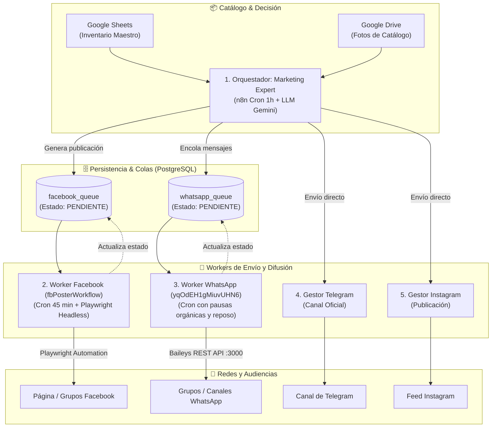

# GESTOR-MARKETING — Hub de Marketing y Distribución Multicanal

Plataforma inteligente de automatización de marketing para la selección de catálogo, generación asistida por modelos LLM y difusión programada de productos hacia **WhatsApp, Facebook, Instagram y Telegram**.

---

## 🏛️ Arquitectura del Sistema

El siguiente diagrama detalla cómo interactúan los flujos de orquestación, las colas en base de datos PostgreSQL y los workers especializados con protección anti-ban:



---

## 📂 Componentes Principales

- `workflow_marketing_expert.json`: Orquestador central de marketing. Evalúa stock disponible, selecciona productos promocionales y genera las publicaciones.
- `workflow_worker_whatsapp.json`: Worker especializado en WhatsApp con cadencia humana, delays aleatorios y política estricta anti-spam.
- `workflow_ingesta_whatsapp.json`: Endpoint de captura y recepción de solicitudes para encolar en WhatsApp.
- `DOCUMENTACION_FLUJOS_GESTOR.md`: Manual técnico exhaustivo que documenta nodo a nodo cada flujo, el modelo de datos relacional y las rutinas anti-ban.
- `docker-compose.yml`: Plantilla de despliegue portable para levantar n8n con los flujos en cualquier servidor o PC local.
- `.env.example`: Variables de entorno requeridas para el funcionamiento del stack.

---

## ⚙️ Variables de Entorno (`.env.example`)

| Variable | Descripción | Ejemplo / Default |
| :--- | :--- | :--- |
| `PORT_N8N` | Puerto local expuesto para n8n | `5678` |
| `N8N_ENCRYPTION_KEY` | Clave secreta para cifrado interno de n8n | Clave segura aleatoria |
| `BAILEYS_API_KEY` | Clave de autenticación para microservicio Baileys | Clave privada |
| `BAILEYS_API_URL` | URL de la API REST de WhatsApp | `http://baileys-sales-api:3000` |
| `LLM_PROXY_TOKEN` | Token Bearer para el gateway LLM (Gemini) | `Bearer sk-...` |
| `OMNIRUTE_BASE_URL` | Endpoint base para inferencia de modelos | `http://172.16.1.1:20128` |

---

## 🚀 Despliegue Portable (Docker)

1. **Configurar el entorno:**
   ```bash
   cp .env.example .env
   ```
   Rellenar las claves en `.env` (este archivo está protegido por `.gitignore` y nunca se sube a repositorios remotos).

2. **Iniciar contenedores:**
   ```bash
   docker compose up -d
   ```

3. **Importar flujos en la instancia:**
   ```bash
   docker exec -it gestor-n8n n8n import:workflow --input=/workflows/workflow_marketing_expert.json
   ```
